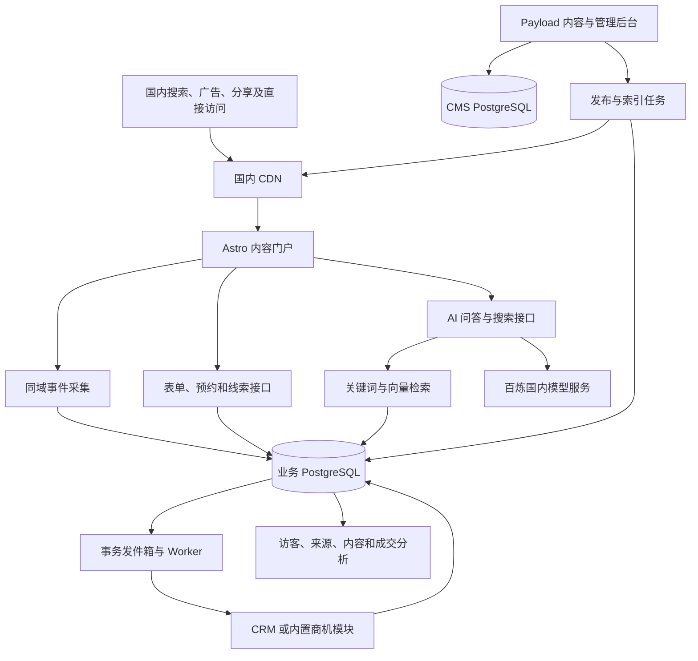

# 川江网站技术栈决策

决策日期：2026-10-14。适用于国内科技企业的软件开发服务门户，目标用户为国内企业客户。

## 1. 建设目标

网站的核心业务链路为：搜索曝光 → 搜索点击 → 内容阅读 → 技术咨询 → 有效线索 → 商机 → 签约。

首期必须能够回答：谁访问过网站、从哪里来、看了什么、咨询了什么、是否留资、销售如何跟进、最终是否成交。

搜索增长与销售闭环并列为核心目标。AI 售前用于帮助客户理解能力、澄清需求，并为销售交接提供依据。公共内容、联系方式和普通表单应在 AI 服务不可用时继续工作。

## 2. 确定采用的技术栈

| 层级 | 决定采用 | 使用范围 |
| --- | --- | --- |
| 开发语言与工作区 | TypeScript、pnpm workspace、Node.js 24 LTS | 门户、后台、异步任务共享类型与业务模块 |
| 内容前端 | Astro 当前稳定版、官方 Node 适配器 | 服务页、行业方案、案例、技术问答、招聘页；Node 服务提供动态接口 |
| 交互组件 | React 岛屿 | AI 咨询、搜索、需求表单、预约、分析图表，按需加载 |
| 样式 | Tailwind CSS v4、CSS 设计令牌 | 统一颜色、字体、间距及组件；字体、图片和脚本由国内资源域提供 |
| CMS 与后台 | Payload 3，自托管；使用其匹配的 Next.js 运行时 | 内容模型、后台账号与权限、版本和草稿；扩展线索、发布状态及分析管理页 |
| 渲染 | 内容页面 SSG；动态接口与预览按需运行 | 公共内容走国内 CDN；CMS 发布触发构建与缓存更新 |
| 业务接口 | Astro API Endpoints、Zod、共享业务服务模块 | 事件采集、AI 问答、表单、预约、外部能力查询；SSE 实现流式回答 |
| 数据库 | 阿里云 RDS PostgreSQL、pgvector | 内容数据与业务数据采用独立数据库及账号；业务数据库保存访客、事件、线索、会话、知识索引与结果 |
| 数据访问 | Payload 使用自身数据库适配器；业务数据库使用 Drizzle ORM 和 SQL 迁移 | 两组迁移各自负责所属数据库，避免共同修改 CMS 内部表 |
| AI 模型 | 阿里云百炼中国内地地域；默认 qwen-plus、text-embedding-v4 | 问答与需求摘要、知识向量生成；通过服务端模型适配模块调用 |
| 检索 | PostgreSQL 关键词索引、中文分词与业务词典、pgvector、RRF 融合排序 | 同时支持产品/服务名称、接口缩写、精确术语和自然语言问题 |
| 缓存与异步任务 | Redis、BullMQ、PostgreSQL 事务发件箱 | 知识索引、CRM 同步、发布任务、汇总计算；任务可重试、可去重 |
| 文件存储 | 阿里云 OSS，公开文件配合 CDN，私有文件使用受控访问 | 图片、白皮书、文档、简历；数据库保存文件元数据 |
| 访客与归因 | 同域第一方采集 API、PostgreSQL 事件表和汇总表、自有分析后台 | 关联匿名访问、来源、咨询、线索和 CRM 结果 |
| CRM 集成 | CRM 适配接口；首期提供内置线索与商机模块 | 记录跟进、报价、签约、金额及流失原因；确定企业现有 CRM 后接入对应连接器 |
| 国内部署 | 阿里云北京地域 ECS、Docker Compose、Nginx、国内 CDN、RDS、OSS、托管 Redis | 门户、CMS、Worker 为独立进程；首期使用同一云服务商 |
| 可观测 | web-vitals、OpenTelemetry、结构化日志、阿里云 SLS/云监控 | 页面性能、接口错误、任务积压、模型耗时与成本、转化链路 |
| 自动交付与验证 | 国内 Git 托管、CI Runner、容器镜像仓库；Vitest、Playwright | 自动构建、预览、业务测试与流程验证；部署保留上一镜像及回滚步骤 |

应用运行环境和主版本在脚手架阶段核验兼容性，所有依赖写入锁文件。CMS 的 Next.js、React 版本遵循 Payload 的兼容要求。模型名称作为初始选择，开通后核验国内地域可用性及流式响应能力，再锁定经过评估的模型版本；云数据库开通前核验 PostgreSQL 与 pgvector 的支持组合。

## 3. 应用边界

采用模块化单体业务设计，门户、CMS、后台任务分别运行，共享业务代码。CMS 内部的 Next.js 用于后台运行，网站内容前台仍由 Astro 提供。

建议工作区：

```text
apps/
  web/          Astro 门户、访客接口、AI 流式接口
  cms/          Payload 内容与业务管理后台
  worker/       索引、发布、CRM 同步和汇总任务
packages/
  domain/       线索、预约、来源归因等业务逻辑
  database/     业务数据库结构、查询与迁移
  contracts/    请求校验、事件定义、工具参数和返回类型
  ai/           模型调用、检索、引用和评估
  integrations/ CRM、日历、消息与搜索平台连接器
  ui/           React 组件、设计令牌
```

Payload 管理页通过共享业务模块读取业务数据，服务端先验证后台账号及角色权限。公开事件、问答、表单接口按用途校验输入和限制访问。浏览器不直接持有模型、数据库或 CRM 密钥。



## 4. 搜索增长与发布

CMS 中建立服务、行业方案、案例、技术问答、文档和职位内容类型。公共页面包含稳定 URL、标题、摘要、正文、面包屑、规范链接及内部关联；核心信息直接包含在 HTML 中。

发布流程为：内容审核 → CMS 发布 → 创建带版本的任务 → 构建公共页面 → 部署并更新缓存 → 同步知识索引。修改、删除、撤回发布同步清理检索内容。过期任务不能覆盖新版本。

后台分别展示 CMS 发布、页面上线、知识索引三个状态。搜索抓取和收录由搜索平台决定，独立监测，不将发布成功视为收录成功。

一期以 SSG 重建及 CDN 更新为主，发布时延实测后确定。需要快速更新的少量公共页面采用 SSR 和显式缓存失效。自托管缓存更新单独实现与验收；Vercel 特有 ISR 配置不作为该部署的能力。

接入百度、必应、360、搜狗等实际支持的站长渠道。Sitemap 和 URL 提交帮助页面发现，不保证收录或排名。搜索展现、搜索词、点击和平均位置，只展示平台实际提供的数据，注明渠道、时间区间和更新时间。

## 5. 访客、来源和结果

身份链路：visitor_id → session_id → lead_id → opportunity_id。

- 匿名访客使用第一方随机编号记录访问，不默认等同于实名联系人。
- 留资后关联本浏览器访问记录；跨设备通过明确身份验证关联。
- 保存首次来源、本次来源、转化前来源、落地页、推广活动参数及 referrer。来源丢失时标为直接或未知。
- 搜索关键词在可获取时记录；来源信息不足时不推断关键词或企业身份。
- 页面浏览与交互由同域采集记录，确保 CDN 缓存命中后仍可记录访问。
- 事件包含唯一 event_id、会话编号、内容编号、发生时间和接收时间，支持去重；来源参数在服务端校验并限制长度。
- 表单、预约、报价、签约等业务结果由服务端或 CRM 记录，区分点击意图与执行成功。
- 原始事件按配置的保留周期清理，长期分析采用汇总数据；联系人信息和可访问对话记录按角色限制。
- 分析结果说明采集覆盖范围，浏览器禁用脚本或阻止采集会造成记录缺失；爬虫和异常流量单独标记。

关键事件：page_view、content_view、search_submitted、ai_question、cta_clicked、lead_created、appointment_booked、sales_contacted、opportunity_qualified、quote_sent、deal_won、deal_lost。

报告按来源、落地页、内容主题和时间范围展示曝光、访问、有效线索、商机和成交。首期同时展示首次接触来源和转化前接触来源，不把单个渠道相关性解释成因果贡献。

## 6. AI 售前与技术图示

检索内容仅包含审核通过、已发布、允许公开的服务能力、案例和文档。分块携带 document_id、版本、URL、章节及发布日期，回答保留对应引用。

中文检索显式处理中文分词、业务词典、MES/ERP 等缩写和别名，不依赖 PostgreSQL 默认全文配置提供中文检索质量。先完成关键词及向量融合召回，用真实中文问题评估，再决定是否需要独立搜索服务或重排模型。

服务端限制问题长度、会话上下文和模型调用预算，提供超时与中止机制。资料不足时说明缺失条件；价格、周期、预约时段和兼容性结论以业务接口或人工确认为准。

结构化需求摘要通过 schema 校验，保留原始依据；线索评分使用明确业务规则，展示评分理由。公共问答页面由编辑审核后发布，私人对话不自动转为公开内容。

架构示意图采用受限结构化节点与连线、可信模板、Mermaid 或 SVG 渲染。生成内容限制长度、节点类型和链接，并标为建议示意；不直接执行模型生成的任意 HTML 或脚本。

## 7. 预约和 CRM

表单确认后先保存线索及同步任务，再返回已收件状态。后台 Worker 同步 CRM，记录失败、重试和处理结果。事务发件箱确保业务写入后不会丢失同步任务。

提交使用幂等键，CRM 同步采用去重或 upsert。邮箱域名仅帮助填写公司信息，由访客确认；具体预约依日历可用时段、北京时间和预约系统成功结果确认。

现有 CRM 产品、日历系统及 API 凭据尚未提供，因此连接器预留标准契约，首期内置线索、跟进、商机及结果记录，保证没有外部 CRM 时仍能完成业务闭环。

## 8. 分期范围

首期：

- 服务、案例、行业方案和技术问答页面；SEO 字段、Sitemap 和站长平台监测。
- 内容角色权限与审批流程；发布及知识索引状态。
- 第一方访问采集、来源归因、访客旅程及渠道效果分析。
- 限定知识范围的智能搜索和带引用的 AI 问答。
- 需求表单、预约、线索评分、跟进与商机结果记录；CRM 适配接口。
- 性能、错误、任务和成本监控；发布与回滚流程。

二期：

- 依据已确认行业和行为做规则推荐，稳定输出公共核心内容；有足够数据后开展 A/B 实验。
- 提供结构化能力查询、文档读取和预约 API；增加支持客户端的 WebMCP 适配层。
- 企业有对外 API 或平台产品时建设 OpenAPI 文档、沙盒、密钥和用量看板。
- 按招聘规模建设简历匹配建议及预约流程，保留人工决策。
- 内容模型预留语言字段，首期以简体中文服务国内访客。

WebMCP 当前为社区草案，能力适配必须检测客户端支持并保留普通网页与 API 入口。WebSkill 尚未指定具体协议和客户端，不作为首期依赖。

## 9. 验收与演进条件

一期上线前验证三条完整流程：搜索落地页到留资、AI 问答到预约、线索到成交/流失回传。检查匿名身份关联、来源保留、重复提交、同步失败恢复、撤回内容索引更新及后台权限。

页面性能按国内真实设备及运营商网络测量，报告 p75 LCP、INP、CLS 和接口延迟。LCP 0.8 秒作为特定测试条件下的优化目标，不能当作所有用户的保证。首期以 p75 LCP ≤ 2.5 秒、INP ≤ 200 毫秒、CLS ≤ 0.1 作为基础目标，再按实际样本调整。

AI 效果使用典型中文问题集检查检索命中、引用支撑、无资料问题处理及需求摘要。测试覆盖内容一致性、幂等和业务闭环，避免只测页面是否打开。

发布回滚保留上一镜像；数据库迁移采取向前兼容策略。数据库与 OSS 配置备份和恢复验证。单应用节点故障风险在上线容量及可用性评估中确认，根据目标增加多实例，而非仅依靠 CDN 判断网站整体高可用。

事件查询持续变慢时增加按月分区或分析存储；内容量及中文检索需求增长时评估独立搜索服务；复杂登录交互成为主体时重新评估前端组织；团队出现独立前端应用与发布周期时再评估微前端。

## 10. 决策依据与待落地配置

已核对的官方能力说明：

- Astro 岛屿与按需交互：https://docs.astro.build/en/concepts/islands/
- Astro Node 自托管与 API 路由：https://docs.astro.build/en/guides/integrations-guide/node/
- Astro React 集成：https://docs.astro.build/en/guides/integrations-guide/react/
- Payload 自托管部署：https://payloadcms.com/docs/production/deployment
- Payload 访问控制：https://payloadcms.com/docs/access-control/overview
- Tailwind v4 浏览器兼容范围：https://tailwindcss.com/docs/compatibility
- WebMCP 草案与能力范围：https://webmachinelearning.github.io/webmcp/

百炼嵌入调用说明：https://help.aliyun.com/zh/model-studio/embedding 。已读取其国内地域调用说明；具体模型与 RDS 扩展组合需在云账号配置时验证。本决策没有进行云资源采购、备案、部署或模型调用。

国内域名和备案信息、现有 CRM、日历系统、访问规模、原始案例资料和搜索平台账号，将在实施相应模块时落实。选型已确定，账户参数不影响先建立项目结构与本地业务流程。
